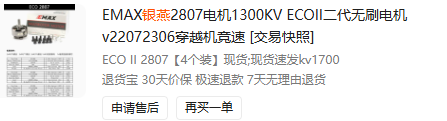
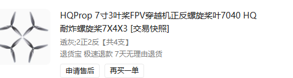
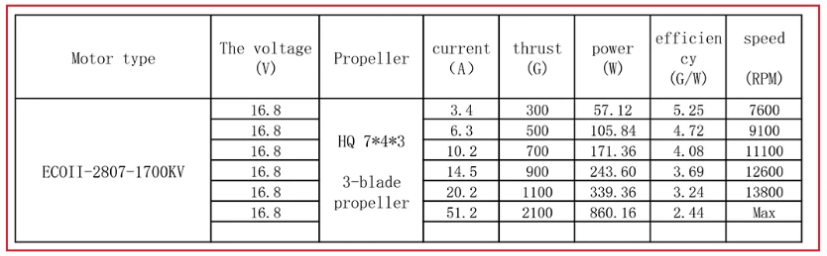

# holydrone identification

ROS1 / PX4 多旋翼响应辨识工具。

# 1 构建

使用 ROS Noetic、Catkin、Eigen3 和 MAVROS。ROS 依赖见 [package.xml](package.xml)；仿真入口还依赖同一工作空间中的 `holydrone` 包及可用的 PX4 / Gazebo 环境。

将本包放在 Catkin 工作空间的 `src/holydrone_identification` 下，在工作空间根目录执行：

```bash
source /opt/ros/noetic/setup.bash
rosdep install --from-paths src --ignore-src -r -y
catkin_make
source devel/setup.bash
```

离线辨识需要 Python 3，以及 `numpy`、`scipy`、`matplotlib`、`PyYAML`、`pyulog`。在用于离线分析的 Python 环境中安装：

```bash
python -m pip install numpy scipy matplotlib PyYAML pyulog
```

下文命令除构建外，均在本仓库根目录执行。离线处理可直接运行 Python，不需要启动 ROS。

# 2 CTBR 1/2/3 阶模型系统辨识

CTBR 指 Collective Thrust and Body Rates，即总推力与机体系三轴角速度。辨识对象是当前飞控与机体组成的四个局部响应通道，各通道独立拟合，不估计通道间耦合。

## 2.1 数学模型

三轴角速度通道以角速度指令为输入、实测角速度为输出；推力通道以归一化推力指令为输入、机体系 Z 轴比力为输出。

| 通道               | 输入 $u$                   | 输出 $y$       | 单位                         |
| ------------------ | ---------------------------- | ---------------- | ---------------------------- |
| roll / pitch / yaw | `cmd_wx / cmd_wy / cmd_wz` | `wx / wy / wz` | 输入、输出均为 rad/s         |
| thrust             | `cmd_thrust`               | `fz`           | 输入为归一化值；输出为 m/s² |

离线数据统一为 FLU（前、左、上）机体系：PX4 FRD 日志中的 pitch、yaw 以及 Z 轴推力、加速度取反。`fz` 是比力，悬停时约为 $9.81\,\mathrm{m/s^2}$，不等于扣除重力后的垂直加速度。在线位置与速度反馈采用 ENU（东、北、上）。

三种模型都描述输入延迟后，输出向 $Ku+b$ 靠近的过程。$K$ 为稳态增益，$b$ 为输出偏置，$d$ 为纯时延（s）；$\tau$ 为时间常数（s），$\omega_n$ 为自然角频率（rad/s），$\zeta$ 为阻尼比。

**一阶模型**用一个时间常数描述主要滞后：

$$
\tau\dot y(t)+y(t)=K u(t-d)+b.
$$

**二阶模型**进一步描述振荡与阻尼：

$$
\ddot y(t)+2\zeta\omega_n\dot y(t)+\omega_n^2y(t)
=\omega_n^2\bigl[K u(t-d)+b\bigr].
$$

**三阶模型**在二阶环节前串联一阶惯性环节，其输入到输出的传递函数（不含常值偏置）为：

$$
G(s)=\frac{K\omega_n^2 e^{-ds}}
{(\tau s+1)(s^2+2\zeta\omega_n s+\omega_n^2)}.
$$

对应时域方程为：

$$
\tau\dddot y+(1+2\zeta\omega_n\tau)\ddot y
+(2\zeta\omega_n+\omega_n^2\tau)\dot y+\omega_n^2y
=\omega_n^2\bigl[K u(t-d)+b\bigr].
$$

每个片段以首个实测输出作为初值；二阶模型假定初始一阶导数为零，三阶模型假定初始一、二阶导数均为零。指令采用零阶保持（ZOH），按真实时间戳预测响应，避免把输入跳变平滑成斜坡。

推力模型还根据稳态关系计算悬停推力：

$$
u_{\mathrm{hover}}=\frac{9.81-b_{\mathrm{thrust}}}{K_{\mathrm{thrust}}}.
$$

## 2.2 拟合方法

**1. 单轴激励与回中。** [统一状态机](src/identification_fsm.cpp)依次执行 roll、pitch、yaw、thrust 正负脉冲，每个脉冲后交还 PX4 位置控制回中。回中、判稳并重新采集有效推力基准后，才开始下一个脉冲，因此总耗时取决于反馈与恢复过程。

统一使用 [pulse_medium.yaml](config/excitation/pulse_medium.yaml)：四通道正负脉冲、每次 0.20 s、重复 3 轮，共 24 个脉冲。采集不选择模型阶数，同一份 ULog 供一、二、三阶离线拟合以及具备所需测量的物理参数辨识使用。

发布频率为 200 Hz，roll / pitch / yaw 幅值分别为 ±0.20 / ±0.20 / ±0.25 rad/s，推力增量为 ±0.015。角速度激励期间，本包用高度反馈调节推力；推力激励期间冻结本次采集的推力基准。恢复、回中与判稳逻辑沿用原实现。

**2. 日志提取与划分。** [日志处理入口](scripts/ctbr/brct1order_process.py)读取 `vehicle_rates_setpoint`、`vehicle_angular_velocity`、`sensor_combined` 和 `vehicle_control_mode`，只保留源数据共同覆盖、已解锁且处于 OFFBOARD 的样本。角速度指令用前值保持对齐，Z 轴比力线性插值到角速度采样时间。

提取器识别等幅反向平台；存在 `offboard_control_mode` 时，进一步筛选纯角速度控制阶段，并将两个方向的平台分为独立片段，排除中间的位置回中过程。随后按“通道 + 脉冲时长”分层，将时间靠后的完整片段留作验证，默认比例为 1/3；每层至少需要两个片段，两集合不共享片段或采样点。这属于同次飞行的留出验证；使用不同飞行日志时才属于跨飞行验证。

拟合前还会排除样本不足、反馈无效、断采或输入变化不足的片段。计划执行的脉冲数与最终可用的拟合片段数可能不同，应以报告及 CSV 为准。

**3. 有界鲁棒拟合。** [一阶](scripts/ctbr/brct1order_regression.py)、[二阶](scripts/ctbr/brct2order_regression.py)、[三阶](scripts/ctbr/brct3order_regression.py)回归模块均使用 SciPy `least_squares`，以 `soft_l1` 损失减小异常值影响。从多个初值分别优化，再按训练残差均方误差选取候选。

| 模型 | 每通道待估参数                | 优化初值数 |
| ---- | ----------------------------- | ---------- |
| 一阶 | $\tau,d,K,b$                | 3          |
| 二阶 | $\omega_n,\zeta,d,K,b$      | 3          |
| 三阶 | $\tau,\omega_n,\zeta,d,K,b$ | 4          |

时间常数范围为 0.003–0.5 s，时延为 0–0.15 s，增益为 0.01–100，偏置为 −20–20。二、三阶阻尼比为 0.1–2，自然频率从 1 Hz 起，上界为 80 Hz 与训练采样率的 0.45 倍中的较小值。

**4. 留出验证。** 每个片段跳过用于初始化的首样本，在剩余样本上计算：

$$
\mathrm{RMSE}=\sqrt{\frac{1}{N}\sum_{i=1}^N(\hat y_i-y_i)^2},\qquad
\mathrm{NRMSE}=\frac{\mathrm{RMSE}}{\max(P_{95}(y)-P_5(y),10^{-6})}.
$$

当前默认通过标准为：

| 检查项                      | 条件                                                                                     |
| --------------------------- | ---------------------------------------------------------------------------------------- |
| 验证 NRMSE                  | 四通道均 ≤ 0.20                                                                         |
| 验证 RMSE                   | 角速度 ≤ 0.15 rad/s；比力 ≤ 1.0 m/s²                                                  |
| 验证输出跨度 $P_{95}-P_5$ | 角速度 > 0.1 rad/s；比力 > 0.3 m/s²                                                     |
| 参数边界                    | 未触发实现中的边界判定；允许零时延                                                       |
| 输入覆盖                    | 训练与验证输入区间有交集，角速度交集还须覆盖零点两侧                                     |
| 采样分辨率                  | 二阶检查验证集自然频率；三阶检查训练、验证集的极点频率尺度，均须低于相应采样率的 0.45 倍 |
| 悬停推力                    | 位于 (0, 1)，且位于推力通道共同验证的输入区间内                                          |

四通道及悬停推力检查全部通过，整体 `passed` 才为 `true`。低预测误差与参数可辨识性需要分别判断，增加模型阶数也不保证改善结果。

## 2.3 使用

**在线采集。** 本包不负责自动起飞、解锁、切入 OFFBOARD 或降落。先人工起飞，在 `POSCTL` 或 `AUTO.LOITER` 下稳定悬停；反馈正常时节点预发送位置目标，人工切入 OFFBOARD 后自动记录原点、回中并执行激励。

已有 MAVROS 连接时，选择一个入口：

```bash
# 一阶
roslaunch holydrone_identification identification_fsm.launch
# 二阶
roslaunch holydrone_identification brct2order.launch
# 三阶
roslaunch holydrone_identification brct3order.launch
```

各入口均支持 `config:=/path/to/config.yaml`。状态可用以下命令查看或停止：

```bash
rostopic echo /identification/status
rosservice call /identification_fsm/stop
```

全部脉冲完成并回中后，`/identification_fsm/finished` 发布 `true`。完成或主动停止后，在反馈有效且仍处于 OFFBOARD 时继续发送位置保持目标；应人工接管并降落，再关闭进程。反馈失效时可能停止发送目标，不能将停止服务视为自动降落。

仓库还提供 GNOME Terminal 多 Tab 启动脚本，同时启动仿真或实机 MAVROS、统一采集节点与会话记录器：

```bash
# 仿真
bash _scripts/simulation/flight/flight_collect.sh
# 实机
bash _scripts/real_flight/excitation/flight_collect.sh
```

实机统一采集脚本位于 `real_flight/excitation/`，仿真入口位于 `simulation/flight/`；其他脚本按功能放在 `ctbr/`（离线拟合）、`gazebo_physics/`、`escmotor/` 子目录中；数据整理入口位于 `_scripts/dataset/escmotor/`。

模型阶数只在离线处理时选择。使用前核对脚本参数区：默认假设本包位于工作空间 `src/`，仿真需配置 PX4、Gazebo 环境与 world 路径，实机默认串口为 `/dev/ttyS0:2000000`、目标 system ID 为 2。结束会话时使用场景目录 `_scripts/simulation/kill.sh` 或 `_scripts/real_flight/kill.sh` 停止已记录的进程组。

**会话与 ULog。** 统一入口在 `data/excitation/experiment/<会话>/` 保存 `config.yaml` 与 `events.jsonl`。事件包含 ROS 接收时间、主机时间和 FSM 状态，不能替代 ULog 内的精确采样时间。仿真原始日志在该会话的 `px4/log/` 下；实机飞行后将完整 `.ulg` 下载到相应会话目录。不会自动下载或裁剪 ULog，也不自动改写飞控日志配置；采集前需确认日志包含所需角速度、指令、比力、四路实际 RPM 等信号及足够的更新率。

直接使用 ROS 统一入口：`roslaunch holydrone_identification flight_collect.launch output:=/绝对路径/新会话目录`。记录器拒绝覆盖已有配置或事件文件。`data/excitation/dataset` 留作后续整理数据，当前采集入口不自动执行入库、拟合或训练集划分。

**离线辨识。** 以下路径为示例，将 `.ulg` 换为实际文件；`--output` 使用新的报告文件名：

```bash
python scripts/ctbr/brct1order_process.py \
  --ulog /path/to/flight.ulg --output data/ctbr/brct1order/report.yaml
python scripts/ctbr/brct2order_process.py \
  --ulog /path/to/flight.ulg --output data/ctbr/brct2order/report.yaml
python scripts/ctbr/brct3order_process.py \
  --ulog /path/to/flight.ulg --output data/ctbr/brct3order/report.yaml
```

使用 `--validation-fraction 0.333333` 可调整同日志的留出比例；若已有独立训练、验证飞行，将 `--ulog` 换成 `--train /path/to/train.ulg --validation /path/to/validation.ulg`。

也可编辑 `_scripts/simulation/ctbr/` 或 `_scripts/real_flight/ctbr/` 下对应的 `brctNorder_identification.sh`，设置 `ULOG`、`OUTPUT` 和 `CONDA_ENV` 后执行。这些离线脚本默认使用名为 `holydrone_autotune` 的 Conda 环境，日志路径需按本次采集更新。

| 输出（以 `report.yaml` 为例） | 内容                                                                                    |
| ------------------------------- | --------------------------------------------------------------------------------------- |
| `report.yaml`                 | 四通道参数、训练/验证误差、通过标志、有效输入区间、悬停推力、源日志与数据哈希、划分信息 |
| `report_train.csv`            | 实际用于训练的片段                                                                      |
| `report_validation.csv`       | 留出验证片段                                                                            |
| `report.png`                  | 四通道指令、实测输出和模型预测曲线                                                      |

程序拒绝覆盖上述已有输出；再次运行需更换输出路径。离线处理只生成报告与图表，不自动将辨识参数写回飞控。`data/` 下的实验文件默认不纳入 Git。

## 2.4 效果

生成的 `report.png` 将训练数据与验证数据分别着色，以虚线叠加模型预测；片段之间留空并省略回中时间。预测以各片段首个实测输出初始化，因此图中的横轴不是整段飞行的连续时间，片段终点也不一定代表稳态。

仓库现有验证记录可用于了解流程与限制：

| 记录                                                    | 已记录结果                                                                       | 证据范围                                                                                         |
| ------------------------------------------------------- | -------------------------------------------------------------------------------- | ------------------------------------------------------------------------------------------------ |
| [一阶历史 SITL 统计](test/results/brct1order.json)       | 24 个脉冲完成，最大高度下降约 0.035 m、最大倾角约 4.81°、最大水平偏移约 0.358 m | 单次空场景仿真中的激励表现，不含拟合通过结论                                                     |
| [三阶实验记录](test/SITL.md#brct-三阶完整实验2026-11-08) | 72 个脉冲完成；验证 NRMSE：roll 3.27%、pitch 2.63%、yaw 1.74%、thrust 5.28%      | 文档记录 roll / yaw 阻尼比触及或贴近下界，整体 `passed: false`；相同 CSV 的二阶对照为 `true` |

上述为历史记录，不代表本次重新运行；三阶记录引用的原始实验报告与图表未随当前仓库提供，不能据此在此处复现数值。运行验证方法见 [SITL 验证说明](test/SITL.md)。评估新结果时，应同时查看 `passed`、验证误差、边界标志和输入覆盖范围，且不将单次仿真结果推广为实飞结论。

# 3 Gazebo 物理模型辨识

# 4 简化模型建立与辨识

## 4.1 基于PX4的控制器与混控器

不需要辨识，请调用px4-sitl仿真

## 4.2 驱动 ESC 电机动力学

台架采集工具：[escmotor_excite.py](scripts/escmotor/escmotor_excite.py)。通过 USB 连接 PX4，按 YAML 中的电压和指令序列逐次等待 Enter 执行，原始数据保存至飞控 SD 卡 ULog。配置、日志准备和运行方式见 [台架实验说明](test/ESC_MOTOR.md)。

输入为 PX4 混控器输出的逐电机归一化指令 $u_i$，输出为各电机的机械角速度 $\Omega_i$（rad/s）：

$$
u_i \xrightarrow{\text{输出驱动}} d_i
\xrightarrow{\text{ESC、电池}} V_i
\xrightarrow{\text{电机与桨负载}} \Omega_i.
$$

$d_i$ 可以是 PWM、DShot 或 CAN 指令，$V_i$ 为等效电机端电压。驱动中的通道映射、死区、限幅、推力线性化，以及 ESC 的输出特性都会影响这条链路，因此不能直接假定 $u_i$ 与转速成正比。

### 4.2.1 电气与机械模型

保留电流动态时，单电机可写为：

$$
L_i\dot I_i=V_i-R_iI_i-k_{e,i}\Omega_i,
\qquad
J_{m,i}\dot\Omega_i=k_{t,i}I_i-Q_{\mathrm{load},i}-Q_{\mathrm{fric},i}.
$$

$I_i$ 为电流，$L_i,R_i$ 为等效电感、电阻，$k_{e,i},k_{t,i}$ 为反电动势与转矩常数，$J_{m,i}$ 为转子系统等效转动惯量；$Q_{\mathrm{load},i}$ 为桨的气动负载转矩，$Q_{\mathrm{fric},i}$ 为摩擦转矩。电池带载电压通过 $V_i=f_{\mathrm{ESC},i}(d_i,V_{\mathrm{bat}})$ 进入模型。

### 4.2.2 一阶近似

用于控制与仿真时，可将上述过程简化为“稳态转速映射 + 一阶滞后”：

$$
\tau_{m,i}\dot\Omega_i+\Omega_i
=\Omega_{i,c}(u_i,V_{\mathrm{bat}}).
$$

$\tau_{m,i}$ 为电机响应时间常数（s）；$\Omega_{i,c}$ 为当前指令和电压下的目标稳态转速，应由 ESC、电机与桨的组合标定。若 $u_i$ 确实表示归一化推力，且静态推力与转速平方成正比，可近似取：

$$
\Omega_{i,c}=\Omega_{i,\max}\sqrt{\max(u_i,0)}.
$$

该开方关系有前提，必须与 PX4、驱动和 ESC 已采用的推力线性化配置一致。电压变化明显时，稳态映射也应随电压变化，不能固定使用一个最大转速。

### 4.2.3 参数辨识实验

三个 Shell 入口依次为（先编辑各脚本参数区的 Conda 环境和数据路径）：

```bash
bash _scripts/real_flight/escmotor/escmotor_excite.sh
bash _scripts/dataset/escmotor/escmotor_expdataprocess.sh
bash _scripts/real_flight/escmotor/escmotor_identification.sh
```

采集后自行取得对应 ULog，连同会话目录整理为 `samples.csv` 和 `dataset.yaml`；辨识入口使用该数据集输出稳态转速表、逐工况一阶启动响应参数及留出验证指标。数据整理与辨识还需要 `pyulog`、`numpy`、`scipy`。当前拟合的是停止后起转响应，具体数据要求见 [台架实验说明](test/ESC_MOTOR.md#shell-入口与离线处理)。

使用 [escmotor_excite.py](scripts/escmotor/escmotor_excite.py) 在台架上采集数据：电脑经 USB 连接 PX4，按照 YAML 中的电压、指令和重复次数逐项激励指定电机。程序独立运行，不需要 ROS；原始数据由飞控写入 SD 卡 ULog。

**实验准备。** 电机固定在台架上，由外部电源供电，USB 用于通信。飞控保持未解锁，执行器测试功能已启用，ESC 能向飞控回传转速；仅有 BDShot 转速时，配置使用飞控电源电压并关闭 ESC 电流强制检查。核对电机编号与 ESC 遥测索引，并关闭占用 USB 串口的 QGC、MAVROS 等程序。

将 [escmotor_logger_topics.txt](scripts/escmotor/escmotor_logger_topics.txt) 复制到飞控 SD 卡的 `etc/logging/logger_topics.txt`，提前备份原文件。该文件为台架专用记录配置，在本机 PX4 分支中会替代默认话题列表，实验后恢复原配置。

**配置实验序列。** 编辑 [config/escmotor/escmotor.yaml](config/escmotor/escmotor.yaml)：

**检查并运行。** 先检查配置，再启动实验；输出目录必须是新的目录：

```bash
python scripts/escmotor/escmotor_excite.py --config config/escmotor/escmotor.yaml \
  --output data/escmotor/session_001 --check-config

python scripts/escmotor/escmotor_excite.py --config config/escmotor/escmotor.yaml \
  --output data/escmotor/session_001
```

**取得数据。** 原始 `.ulg` 保存在飞控 SD 卡，需要实验后自行下载。电脑输出目录保存 `config.yaml` 配置快照和 `events.jsonl` 实验清单，后者包含执行顺序、异常、稳态检查结果以及飞控日志路径。离线从 ULog 提取 `actuator_test`、`actuator_outputs`、`esc_status` 和 `battery_status`，并检查实际更新率与丢样情况。

## 4.3 旋翼气动

本节按同一 [Notion 页面](https://app.notion.com/p/4133520427fd80499607c2e4750aff71)的固定旋翼轴、低速静态气动近似整理。输入为实际转速 $\Omega_i$，输出为旋翼施加到机体的力与力矩。初步模型忽略动态入流、桨叶挥舞和转子角动量效应，参数主要适用于标定所覆盖的来流和转速范围。

### 4.3.1 推力与反扭矩模型

单旋翼的推力大小和气动反扭矩大小近似与转速平方成正比：

$$
F_i=k_{f,i}\Omega_i^2,\qquad Q_i=k_{m,i}\Omega_i^2.
$$

$k_{f,i}$ 为推力系数，$k_{m,i}$ 为反扭矩系数，分别以 N/(rad/s)² 和 N·m/(rad/s)² 表示。设 $\mathbf r_i$ 为桨轴相对质心的位置（m），$\mathbf a_i$ 为单位推力方向，$\epsilon_i\in\{-1,+1\}$ 表示机体所受反扭矩沿 $\mathbf a_i$ 的符号，则：

$$
\mathbf f_B=\sum_i k_{f,i}\Omega_i^2\mathbf a_i,
\qquad
\boldsymbol\tau_B=\sum_i\left[
k_{f,i}(\mathbf r_i\times\mathbf a_i)
+\epsilon_i k_{m,i}\mathbf a_i\right]\Omega_i^2.
$$

力矩包含推力相对质心产生的力矩，以及与旋向有关的气动反扭矩。这里使用真实力臂和物理系数，不能用 PX4 的归一化混控矩阵直接替代。

Notion 使用 FRD（前、右、下）机体系，常规向上推力的 $\mathbf a_i=-\mathbf e_3$。忽略其他非重力作用时，四旋翼的机体 Z 轴比力为：

$$
f_{z,B}^{\mathrm{FRD}}=-\frac{1}{m}\sum_{i=1}^4 k_{f,i}\Omega_i^2.
$$

$m$ 为整机质量（kg）。本仓库前文辨识数据使用 FLU（前、左、上），相同推力对应正的 Z 轴比力。旋翼模块给出的是力和力矩；角速度响应还需由后续刚体转动动力学计算。

### 4.3.2 查表法

稳态推力也可直接使用匹配电机与桨的实测表格，以转速为索引插值得到 $F_i=\mathcal T_i(\Omega_i)$。若有反扭矩测量，还可建立 $Q_i=\mathcal Q_i(\Omega_i)$。查表描述稳态气动关系，前一节的时间常数描述转速过渡过程，两者需分别确定。

Holydrone 电机与桨的采购截图如下：

<p align="center">
  
  
</p>

现有静态推力表：



表中标注为 **ECOII-2807-1700KV、HQ 7×4×3 三叶桨、16.8 V**。采购标题显示电机 1300KV、桨叶 7×3，需先核对实际安装型号及规格；在确认一致前，该表只能作为参考，不能直接视为当前机体的标定结果。查表与平方模型的使用步骤如下，属于依据上述模型补充的工程整理：

1. 将表中以克重表示的推力换算为 N：$F=G\times9.81/1000$；将机械 rpm 换算为 rad/s：$\Omega=2\pi n/60$。
2. 在有转速记录的有效区间内插值查询推力，避免未经验证地外推。表中最大推力行未给出转速，不能用作“转速—推力”标定点。
3. 若需要压缩为平方模型，令 $x_j=\Omega_j^2$，用过原点最小二乘估计 $k_f=\sum_j x_jF_j/\sum_j x_j^2$，再检查各点残差。
4. 用匹配实际电机、桨与工况的独立测量验证。表中的电功率包含 ESC、电机等损耗，不能直接用电功率除以转速得到桨的气动反扭矩，因此该表本身不足以确定 $k_m$。

对应实现位于 [scripts/blade](scripts/blade/README.md)：按厂家和暑假实测两个独立实验的 CSV 拟合过原点平方模型，并提供有效 RPM 区间内的分段线性查表、残差和曲线输出。运行 `conda run --no-capture-output -n holydrone_autotune python scripts/blade/blade_fit.py`，默认拟合厂家表；添加 `--experiment summer_measurement` 可拟合暑假实测，结果分别写入 `data/blade/dataset/fits/<experiment_id>/`。原始数据见 [blade_experiment](data/blade/experiment/README.md)，运行 `python3 scripts/blade/blade_catalog.py` 重建 [blade_dataset](data/blade/dataset/README.md)。上述图片与拟合结果不代表已完成当前机体的旋翼参数标定。

## 4.4 刚体动力学

### 4.4.1 用双线摆测量整机转动惯量

本项目采用双线摆作为地面惯量测量方案：用两根细线悬挂整机，轻轻扭转后释放，由自由扭摆周期计算绕悬挂轴的惯量。先测偏航惯量 $I_{zz}$，再通过改变安装姿态测量 $I_{xx}$、$I_{yy}$。这项实验不需要电机产生推力，因此可以独立于旋翼力矩系数获得惯量，供后续飞行辨识使用。以下为实验操作与离线计算说明，尚不代表已完成实测或已有自动处理程序。

**测量对象与装置**

目标是飞行配置下整机绕质心的惯量，坐标采用机体 FLU（前、左、上），单位为 $\mathrm{kg\,m^2}$。电池、桨、载荷的位置应与待分析日志一致，所有部件固定，电机保持停转；若用飞控记录陀螺仪，保持动力输出禁用，避免外接线缆牵拉机体。

准备刚性上支架、两根等长且低伸长的细线、必要的轻质夹具、秤和量尺。两根线静止时竖直平行，上下挂点间距均为 $d$，受载线长均为 $L$。悬挂组合的质心应位于两线中间的竖直转轴上，夹具应让飞机的待测轴与这条转轴重合。

```text
          刚性上支架
       ●───── d ─────●
       │             │
     L │      ⋮      │ L      ⋮：竖直扭摆轴
       │      ⋮      │
       ●───── d ─────●        下挂点固定在飞机或夹具上
          飞机＋夹具
       绕竖直轴小角度扭转
```

| 待测量     | 安装姿态                    | 用于提取周期的机体陀螺仪通道 |
| ---------- | --------------------------- | ---------------------------- |
| $I_{zz}$ | 飞机水平，机体 $z$ 轴竖直 | $\omega_z$                 |
| $I_{xx}$ | 通过夹具使机体 $x$ 轴竖直 | $\omega_x$                 |
| $I_{yy}$ | 通过夹具使机体 $y$ 轴竖直 | $\omega_y$                 |

三个方向分别安装、测量和扣除夹具惯量。不能仅凭机架外形对称就令 $I_{xx}=I_{yy}$；这三次测量得到的是惯量矩阵的对角项，不能据此证明非对角项为零。

**周期为什么能确定惯量**

飞机扭转时，两根线发生倾斜，使悬挂物略微升高，重力因此产生恢复力矩。对于小扭角 $\theta$、弱阻尼和近似纯扭摆运动：

$$
I_{\mathrm{susp}}\ddot\theta+\frac{mgd^2}{4L}\theta=0,
\qquad
T=2\pi\sqrt{\frac{4LI_{\mathrm{susp}}}{mgd^2}},
$$

因此：

$$
\boxed{I_{\mathrm{susp}}=\frac{mgd^2T^2}{16\pi^2L}}.
$$

其中 $m$ 是飞机与随动夹具的总质量（kg），$L$ 为受载线长（m），$d$ 为两根线之间的**完整间距**（m），$T$ 为完整扭摆周期（s）。此式假设线的质量和自身抗扭刚度可以忽略；上下挂点间距不同、线不平行或出现明显摇摆时，不能直接套用。双线摆测量多旋翼偏航惯量的实验可参考 [Mukras 与 Omar 的测试平台论文](https://www.mdpi.com/2226-4310/8/11/355)。

**实际测量步骤**

1. **固定配置并找质心。** 记录机型、电池、载荷和安装位置，通过支承平衡或不同方向悬挂确定质心位置。调整挂点与夹具，使待测轴竖直并尽量穿过飞机质心，同时让悬挂组合保持平衡。
2. **称重并测几何尺寸。** 记录悬挂总质量 $m$、受载线长 $L$、上下挂点间距 $d$；检查两线等长、平行，支架和挂点无明显变形。每次改变安装姿态后重新核对。
3. **施加小角度初始扭转。** 可先以约 $3^\circ$～$5^\circ$ 作为操作起点，静止释放，不额外推一下。应主要表现为绕竖直轴往复扭转；若出现明显横向摆动、俯仰摇晃或部件相对运动，重新释放。
4. **记录多个完整周期。** 用机载陀螺仪或固定机位视频记录。建议选连续 10～20 个周期，使用同号峰值或同方向过零点计时；若起止时刻之间有 $N$ 个完整周期，则 $T=(t_{k+N}-t_k)/N$。相邻正峰与负峰之间只有半个周期，不能混用。
5. **重复并检查一致性。** 每个轴建议至少重复 5 组，逐组计算惯量。改变一次线长或间距、适当减小初始角度后复测；结果应在测量不确定度内一致。若随振幅变化明显或振幅快速衰减，应先排查耦合摆动、摩擦和阻尼，不能继续直接按弱阻尼公式取值。
6. **扣除夹具和轴线偏移。** 按下式换算为飞机绕自身质心的惯量，保存原始记录、重复结果和误差估计，再用于辨识。

**夹具扣除与平行轴修正**

上式首先给出整个悬挂组合绕实际扭摆轴的惯量。设飞机质量为 $m_{\mathrm{air}}$，飞机质心到该轴的垂直距离为 $e$，则：

$$
I_{\mathrm{air},C}
=I_{\mathrm{susp}}-I_{\mathrm{fixture},O}-m_{\mathrm{air}}e^2.
$$

$I_{\mathrm{fixture},O}$ 必须是夹具绕**组合实验中同一条轴**的惯量，可由可靠的 CAD 质量属性或单独标定得到。若单独悬挂夹具时转轴发生变化，需先换算到组合实验的轴，不能直接相减。优先用轻夹具并对准质心，避免两个大惯量相减或较大的偏心修正放大误差；复杂耦合摇摆不能仅靠 $m_{\mathrm{air}}e^2$ 修正。

**记录精度与接入本项目**

每组至少保存：测量轴、飞行配置、$m$、$L$、$d$、周期数 $N$、总时长、$T$、夹具惯量、偏移 $e$、修正后惯量以及原始视频或陀螺仪数据路径。对相互独立的小测量误差，悬挂组合惯量的一阶相对标准不确定度近似为：

$$
\left(\frac{\sigma_I}{I}\right)^2
\approx
\left(\frac{\sigma_m}{m}\right)^2
+4\left(\frac{\sigma_d}{d}\right)^2
+4\left(\frac{\sigma_T}{T}\right)^2
+\left(\frac{\sigma_L}{L}\right)^2.
$$

因此，间距和周期的相对误差会以两倍权重影响惯量；连续测多个周期能够减轻计时误差。最终飞机惯量的不确定度还要包含夹具扣除、质心定位、轴线对准及重复安装的影响，不能只填写多次测量均值的标准误。

将测量结果写入 [config/gazebo_physics/parameter_priors.yaml](config/gazebo_physics/parameter_priors.yaml)：只测偏航时使用 `inertia_prior_axes: [2]`，测三轴时使用 `[0, 1, 2]`；按相同顺序填写 `inertia_prior_kg_m2` 和 `inertia_prior_std_kg_m2`，在 `inertia_prior_source` 中记录方法、日期、飞行配置、夹具扣除及不确定度依据，最后设置 `enabled: true`。离线分析通过 `--priors config/gazebo_physics/parameter_priors.yaml` 显式加载；拟合器将实测惯量作为带不确定度的软约束，不会自动写入飞控。实机结果只用于匹配的机体配置，不能直接当成另一架仿真飞机的惯量先验。
